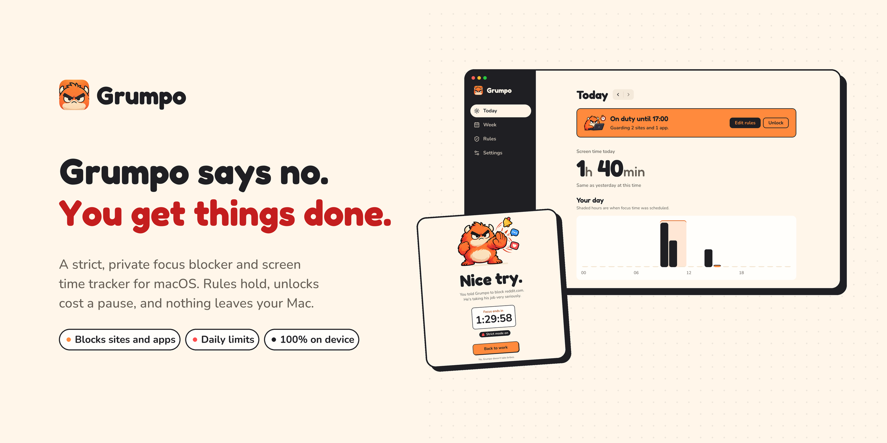
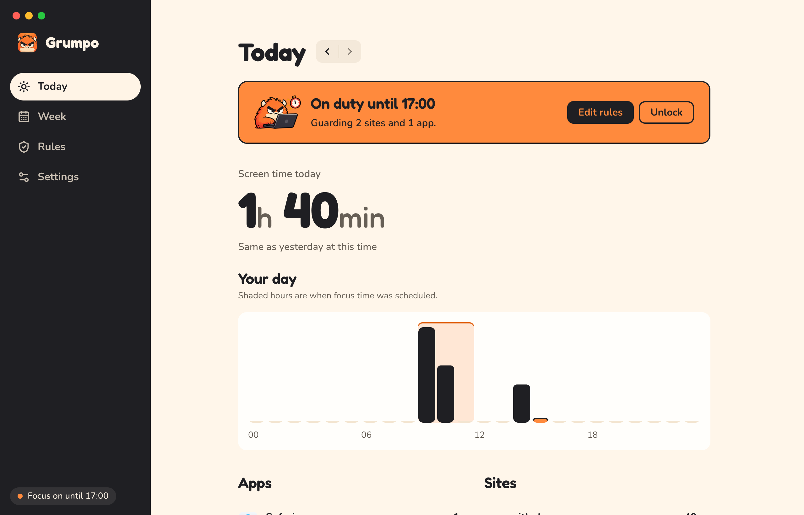
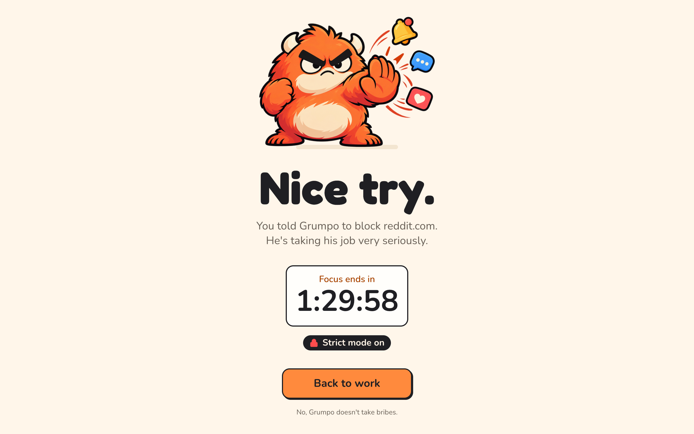

<p align="center">
  <a href="https://github.com/brian-rey-development/grumpo/actions/workflows/ci.yml"></a>
  <a href="#license"></a>
  
</p>

<p align="center">
  <a href="https://brian-rey-development.github.io/grumpo/">Website</a> ·
  <a href="#install">Install</a> ·
  <a href="#how-it-works">How it works</a> ·
  <a href="#unlocking">Unlocking</a> ·
  <a href="#privacy">Privacy</a> ·
  <a href="#build-from-source">Build from source</a>
</p>

Grumpo is a strict focus blocker and screen time tracker for macOS. You tell him which sites and apps are off limits and when, and he keeps them closed, with a root service that blocks sites in every browser and an app that quits blocked apps, closes blocked tabs and shows where your time goes. Loosening a rule while focus time is on costs a cooldown and a typed sentence, so it survives the impulse it exists to stop.

|                          |                                                                                                    |
| ------------------------ | -------------------------------------------------------------------------------------------------- |
| **Blocks for real**      | Sites are written into `/etc/hosts` by a root service, so they fail in every browser, even when the app is closed. |
| **Schedules and limits** | Block sites and apps always or on a weekly schedule, and give anything a daily limit that resets at midnight. |
| **Slow to unlock**       | An unlock waits 5, 10, 20 or 40 minutes depending on how many you used today, then asks you to retype a sentence. |
| **Shows your time**      | Today and Week show your hours, top apps and sites, and progress toward each limit.                |
| **Private by design**    | Only the app, the domain and timestamps are stored, on your Mac. No account and no telemetry, and the only request is a daily update check. |

## Install

Download [Grumpo.dmg](https://github.com/brian-rey-development/grumpo/releases/latest/download/Grumpo.dmg), open it and drag Grumpo into Applications. The download is a universal build for Apple silicon and Intel Macs running macOS 13 or later. You can also install from Terminal, which skips the warning below because `curl` does not mark what it downloads.

```sh
curl -fsSL https://brian-rey-development.github.io/grumpo/install.sh | bash
```

Grumpo is not notarized by Apple, so the first time you open a downloaded copy macOS refuses. Open System Settings, go to Privacy & Security and choose Open Anyway, which you only need to do once, because Grumpo updates itself from then on. When it starts, a short welcome flow explains what it does, installs the background service, which asks for your Mac password once because it runs as root, and asks for the permissions below. Every release is signed with the same certificate, so the permissions you grant carry over to each update.

**Permissions.** Automation is granted per browser, so press Allow next to Chrome, Brave, Edge or Safari, which lets Grumpo read the active tab and close a blocked one. Accessibility is needed only for Firefox, whose active tab cannot be scripted. Both can be refused, in which case Grumpo still tracks time per app and still blocks sites through the hosts file, and only loses the per-site breakdown and tab closing for that browser.



## How it works

Grumpo samples the frontmost app every 2 seconds and, in Chrome, Brave, Edge and Safari, the host of the active tab, with a best effort reading of Firefox through the Accessibility API. Time counts while you are using the Mac, so two minutes without input end a session unless the frontmost app is playing video or in a call, and nothing counts while the screen is locked or the Mac sleeps.

A rule is enforced from two sides. The root daemon, `grumpod`, writes blocked sites into a marked block of `/etc/hosts` while a schedule window is open or a limit is spent, covering the bare domain and the prefixes `www.`, `m.`, `mobile.`, `old.`, `new.`, `music.`, `i.` and `amp.` in IPv4 and IPv6. The app, running as you, quits blocked apps and closes the tab of a blocked site in the frontmost window of Chrome, Brave, Edge and Safari, and explains each action with the block screen, a small window that stays on top, names what Grumpo just closed and counts down to the end of the block. A daily limit warns once when 5 minutes remain, then blocks its target until local midnight.



Grumpo, Finder, the login window, System Settings and the Dock can never be blocked or limited, because quitting any of them would break the Mac or the unlock flow itself. Quitting the app stops it from closing apps and tabs, but the hosts block keeps running in the daemon, so while blocking is active the menu bar entry reads "Quit Grumpo (stops app and tab blocking)".

## Unlocking

Tightening a rule always works immediately, whereas loosening one while enforcement is active requires an unlock. A request starts a cooldown of 5, 10, 20 or 40 minutes, growing with each unlock of the day and resetting at midnight. When it ends, Grumpo sends a notification and you have 5 minutes to retype a fixed sentence, which cannot be pasted, and choose an unlock of 15, 30 or 60 minutes. Relock now is always available, in the app and in the menu bar.

Limits follow a stricter rule, because spent time is the one thing a limit protects. Adding or lowering a daily limit is always free, while raising or removing one needs an active unlock whatever the schedule says.

## Privacy

Grumpo stores only the app id, the app name, the website domain and timestamps. It never stores URLs, paths, queries, page titles or window titles, and its only network request is a daily check of the latest release on GitHub, which sends nothing about you and can be turned off in Settings, so there is no telemetry, no analytics and no remote favicons. Time in a Chrome, Brave or Edge incognito window counts toward limits in memory only and is never written to disk. [docs/privacy.md](docs/privacy.md) explains what is stored, where it lives and how to delete it.

## Known limits

The hosts block applies to every account on the Mac, because `/etc/hosts` is shared, but only the owner can reach the daemon, so another account is blocked from the listed sites without being able to change the rules or unlock. A site installed as a web app, such as a Chrome app or a Safari web app in the Dock, runs as an app with its own bundle id, so block the wrapper as an app in the Rules screen to cover it. Grumpo is built to outlast an impulse rather than an administrator determined to remove it, and [docs/threat-model.md](docs/threat-model.md) lists every way around it.

## Uninstall

Run `sudo scripts/uninstall.sh` from a clone of this repository to remove the daemon and its hosts block, and add `--purge` to delete the daemon state and logs in `/Library/Application Support/Grumpo` and `/Library/Logs/Grumpo` as well. The script also removes the Grumpo login item, and `--owner <user|uid>` picks another account. Then quit Grumpo from the menu bar and delete `/Applications/Grumpo.app`. The usage database lives in `~/Library/Application Support/io.github.brian-rey-development.grumpo` and the app logs in `~/Library/Logs/Grumpo`, so delete those folders to remove every trace. The daemon paths keep the project's earlier name, Focus, on purpose, as [ADR 0012](docs/adr/0012-grumpo-rebrand-and-block-screen.md) explains.

## Build from source

You need Rust (pinned by `rust-toolchain.toml`), Node.js 22 and pnpm. `scripts/build-release.sh` builds `grumpod`, builds and signs `Grumpo.app` with the signed daemon and its installer inside, verifies both signatures with `codesign --verify --strict`, and copies the results into `dist/release/`, and `--universal` builds for both architectures. `scripts/package-dmg.sh` then packs the app into `dist/release/Grumpo.dmg` with a checksum.

```sh
scripts/build-release.sh
rm -rf /Applications/Grumpo.app && ditto dist/release/Grumpo.app /Applications/Grumpo.app && open /Applications/Grumpo.app
```

Without further setup the script signs ad hoc, and an ad hoc signature changes with every build, so macOS asks again for Automation after each rebuild, while Accessibility fails silently until you run `tccutil reset Accessibility io.github.brian-rey-development.grumpo` and grant it again. To keep the grants, create a self-signed code signing certificate once in Keychain Access, under Certificate Assistant, Create a Certificate, with the type Code Signing, and build with `FOCUS_SIGNING_IDENTITY="<certificate name>" scripts/build-release.sh`.

To install the service from Terminal instead, which is the path for a machine without a graphical session, run the installer yourself. It is idempotent, keeps a backup it restores on failure, and on a machine that still has the old `focus-hosts` setup it imports the domain list and schedule before removing the legacy LaunchDaemon.

```sh
scripts/build-release.sh && sudo scripts/install.sh --binary dist/release/grumpod
```

If you ran this app under its earlier name, Focus, quit it first and remove `/Applications/Focus.app`. Your history and settings move to the new data folder on first start, and `tccutil reset All io.github.brian-rey-development.focus` clears the stale permission entries the old app left in System Settings.

## Development

In the `app` directory, `pnpm install` followed by `pnpm tauri dev` starts the app, and `scripts/check.sh` runs every quality gate. A development app talks to a daemon you start yourself against a temporary root, and [docs/development.md](docs/development.md) covers that setup and how to add a Tauri command end to end. The landing page lives in `site/`, an Astro and Tailwind project that `pnpm dev` serves locally and `.github/workflows/site.yml` deploys to GitHub Pages, at `https://<owner>.github.io/grumpo/` by default or at your own domain once the repository variable `SITE_DOMAIN` is set. It ships structured data for the app, the FAQ and the install steps, a sitemap, `robots.txt`, `llms.txt` and the Terminal installer, and it redeploys whenever a release is published. `scripts/brand/generate.py` rebuilds the cover, social previews, logos, favicons and site images from `brand/` and `docs/images/`.

Pushing a `v*` tag that matches the app version builds a universal `Grumpo.dmg` and the signed update archive with its `latest.json`, and attaches them to a draft release, which reaches the website and installed copies once you publish it. Running the Release workflow by hand does the same build without releasing, to try the signing setup. The workflow needs four secrets, which `scripts/create-release-keys.sh --upload` creates once and stores, keeping a backup in `~/.grumpo-signing` that you should save somewhere safe, and [ADR 0013](docs/adr/0013-self-signed-releases-and-automatic-updates.md) explains why releases carry a self-signed certificate and how updates work.

```
crates/focus-core     pure library for rules, unlock, enforcement plan, hosts rendering and IPC protocol
crates/grumpod         root LaunchDaemon that owns rules and the hosts file
app/                  Tauri app (React UI in app/src, Rust backend in app/src-tauri)
site/                 landing page (Astro, Tailwind)
brand/                mascot, stickers, icon, logos and cover art
packaging/macos/      LaunchDaemon plist and log rotation config
scripts/              check, build-release, package-dmg, package-update, release keys, install, uninstall, gen-bindings, ci/, brand/
docs/                 architecture, privacy, threat model, development guide, ADRs and screenshots
```

The design is explained in [docs/architecture.md](docs/architecture.md), the limits of the protection in [docs/threat-model.md](docs/threat-model.md), and the reasoning behind major choices in [docs/adr](docs/adr/README.md). Contributions are welcome, and [CONTRIBUTING.md](CONTRIBUTING.md) describes the gates and conventions, while security reports go through [SECURITY.md](SECURITY.md).

## License

The code is licensed under either of the [MIT License](LICENSE-MIT) or the [Apache License, Version 2.0](LICENSE-APACHE), at your option. Unless you explicitly state otherwise, any contribution you intentionally submit for inclusion in the work, as defined in the Apache-2.0 license, shall be dual licensed as above, without any additional terms or conditions.

The Grumpo name, mascot, stickers, wordmark, cover art and app icon are not open source, and [brand/LICENSE.md](brand/LICENSE.md) describes how you may use them.
